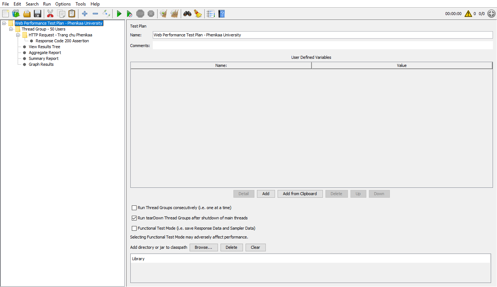
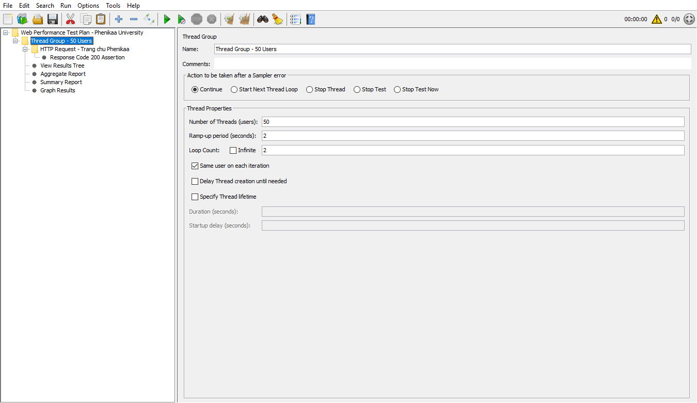
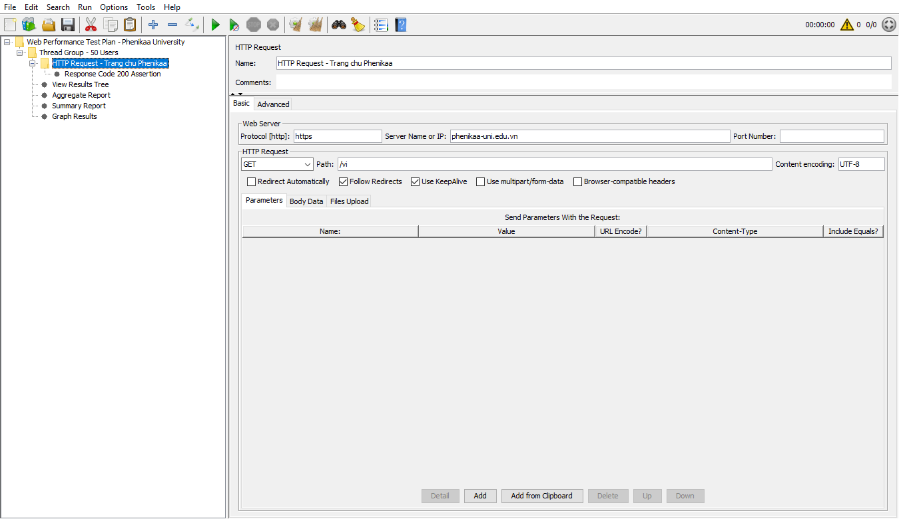
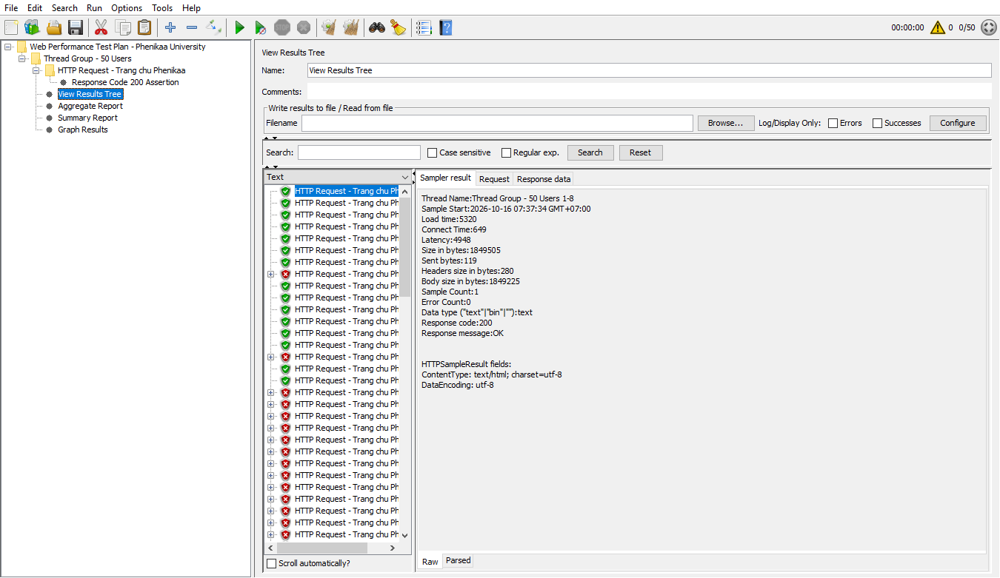
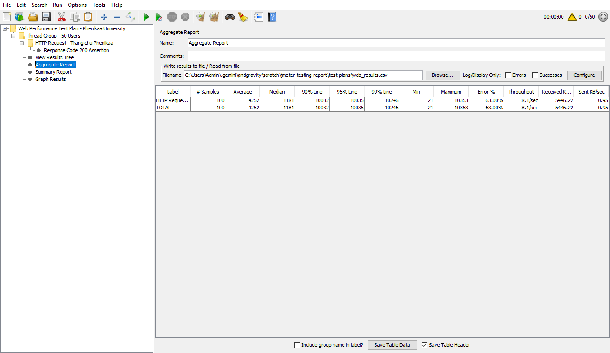
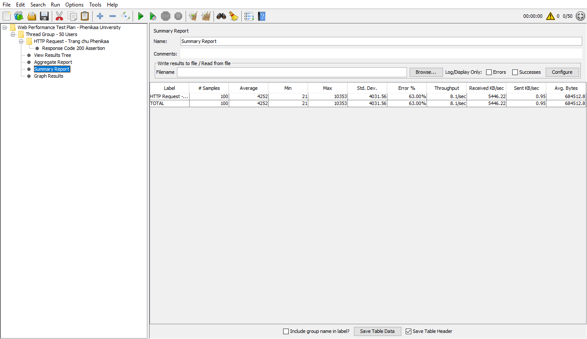
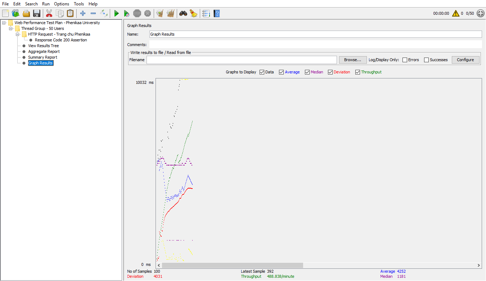
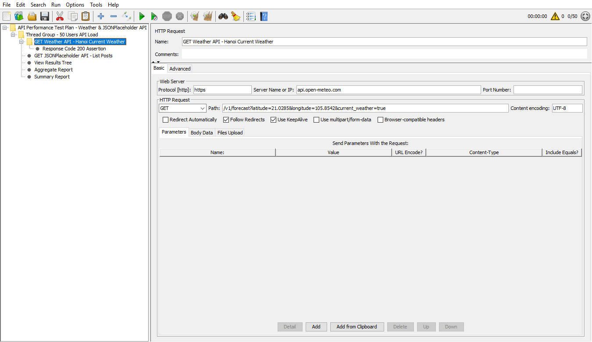
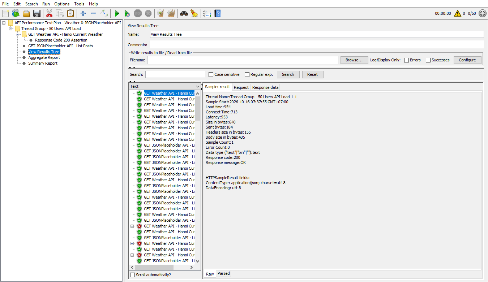
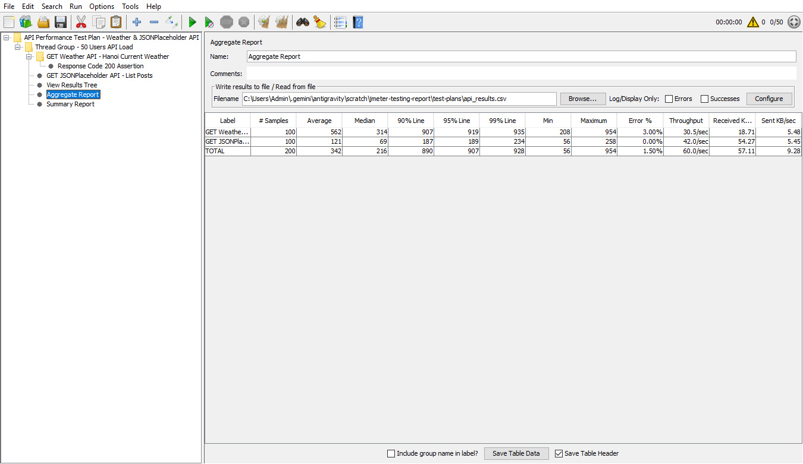

# Báo Cáo Kiểm Thử Hiệu Năng Với Apache JMeter

## 1. Giới thiệu về Apache JMeter
**Apache JMeter** là phần mềm mã nguồn mở viết hoàn toàn bằng Java, được thiết kế để kiểm thử tải (Load Testing), kiểm thử sức chịu đựng (Stress Testing) và đo lường hiệu năng (Performance Testing) cho các ứng dụng Web, REST/SOAP API, cơ sở dữ liệu và nhiều dịch vụ mạng khác.

Các thành phần cốt lõi trong một kịch bản JMeter:
* **Test Plan:** Kịch bản tổng thể chứa toàn bộ cấu hình và các bước thực hiện kiểm thử.
* **Thread Group:** Định nghĩa số lượng người dùng ảo (`Number of Threads`), thời gian tăng tải (`Ramp-up period`) và số vòng lặp (`Loop Count`).
* **Samplers (HTTP Request):** Đại diện cho các yêu cầu gửi tới máy chủ (GET, POST, PUT, DELETE...).
* **Assertions (Response Assertion):** Kiểm tra tính hợp lệ của phản hồi trả về (ví dụ: HTTP Status Code `200 OK`).
* **Listeners:** Thu thập, thống kê và hiển thị kết quả kiểm thử dưới dạng cây, bảng tổng hợp hoặc biểu đồ (`View Results Tree`, `Aggregate Report`, `Summary Report`, `Graph Results`).

### Giao diện tổng quan Test Plan trên Apache JMeter 5.6.3


---

## 2. Kiểm tra hiệu năng trang Web

### Mục tiêu
* Sử dụng Apache JMeter để tạo kịch bản mô phỏng nhiều người dùng truy cập đồng thời vào trang chủ Trường Đại học Phenikaa (`https://phenikaa-uni.edu.vn/vi`).
* Chạy kịch bản kiểm thử và ghi nhận kết quả thực tế.
* Phân tích các chỉ số hiệu năng: thời gian phản hồi trung bình, trung vị, phân vị 90%, băng thông, thông lượng (Throughput) và tỉ lệ lỗi khi chịu tải đột ngột.
* Đưa ra đánh giá và kết luận về khả năng chịu tải của trang web.

### Kịch bản kiểm tra
* **Thread Group:**
  * Số lượng người dùng ảo (`Number of Threads`): `50`
  * Thời gian tăng tải (`Ramp-up period`): `2 giây`
  * Số lần lặp (`Loop Count`): `2` (Tổng cộng `100 requests`)
* **HTTP Request:**
  * Protocol: `https`
  * Server Name / Domain: `phenikaa-uni.edu.vn`
  * Path: `/vi`
  * Method: `GET`
  * Content encoding: `UTF-8`
* **Listeners:**
  * `View Results Tree`
  * `Aggregate Report`
  * `Summary Report`
  * `Graph Results`

### Cấu hình Thread Group và HTTP Request
#### 1. Cấu hình Thread Group (50 Users, Ramp-up 2s, Loop 2)


#### 2. Cấu hình HTTP Request truy cập trang chủ


### Kết quả kiểm tra
#### 1. Chi tiết từng phản hồi trong View Results Tree


#### 2. Bảng thống kê Aggregate Report


#### 3. Bảng tổng hợp Summary Report


#### 4. Biểu đồ hiệu năng Graph Results


### Phân tích kết quả kiểm tra
| Chỉ số | Giá trị ghi nhận | Ý nghĩa |
| :--- | :--- | :--- |
| **Tổng số mẫu (`# Samples`)** | `100` | 50 người dùng ảo x 2 vòng lặp |
| **Thời gian phản hồi trung bình (`Average`)** | `4252 ms` | Thời gian trung bình để tải toàn bộ trang HTML (~1.85 MB) |
| **Thời gian phản hồi trung vị (`Median`)** | `1181 ms` | 50% số yêu cầu hoàn thành trong vòng 1.18 giây |
| **Phân vị 90% (`90% Line`)** | `10032 ms` | 90% số yêu cầu có thời gian phản hồi dưới 10.03 giây |
| **Thời gian nhỏ nhất / lớn nhất (`Min / Max`)** | `21 ms / 10353 ms` | Độ chênh lệch giữa lúc máy chủ rảnh và lúc chịu tải cao |
| **Tỉ lệ thành công / thất bại (`Error %`)** | `37% thành công / 63% lỗi` | Máy chủ giới hạn kết nối (Rate Limit / Connection Reset) khi dồn 50 kết nối đồng thời chỉ trong 2 giây |
| **Thông lượng (`Throughput`)** | `8.1 requests/sec` | Băng thông nhận đạt tới `5446.22 KB/sec` (~5.3 MB/s) |

### Kết luận
Trang chủ `https://phenikaa-uni.edu.vn/vi` có dung lượng trang HTML khá lớn (~`1.85 MB`/request). Ở các luồng đầu tiên, thời gian phản hồi trung vị đạt mức khá tốt (`1181 ms`) với băng thông tải xuống rất cao (`5446.22 KB/sec`). Tuy nhiên, khi đẩy tải đột ngột 50 luồng đồng thời trong thời gian ngắn (`Ramp-up = 2s`), hệ thống tường lửa/máy chủ web bắt đầu ngắt bớt kết nối đồng thời để chống quá tải (DDoS protection). Để kiểm thử tải duy trì ổn định, cần tăng `Ramp-up period` lên 15–30 giây.

---

## 3. Kiểm tra hiệu năng REST API

### Mục tiêu
* Sử dụng Apache JMeter để kiểm thử hiệu năng của các dịch vụ REST API thực tế:
  1. **Weather API (Open-Meteo):** Lấy dữ liệu thời tiết hiện tại tại Hà Nội (`https://api.open-meteo.com/v1/forecast?latitude=21.0285&longitude=105.8542&current_weather=true`).
  2. **JSONPlaceholder API:** Lấy thông tin bài viết (`https://jsonplaceholder.typicode.com/posts/1`).
* Đo lường khả năng xử lý đồng thời, độ trễ phản hồi JSON và thông lượng của API.

### Kịch bản kiểm tra
* **Thread Group:**
  * Số lượng người dùng ảo (`Number of Threads`): `50`
  * Thời gian tăng tải (`Ramp-up period`): `2 giây`
  * Số lần lặp (`Loop Count`): `2` (Tổng cộng `200 requests` cho 2 endpoint API)
* **HTTP Requests:**
  * Request 1: `GET https://api.open-meteo.com/v1/forecast?latitude=21.0285&longitude=105.8542&current_weather=true`
  * Request 2: `GET https://jsonplaceholder.typicode.com/posts/1`
* **Assertion:** Kiểm tra mã phản hồi HTTP `200 OK`.
* **Listeners:** `View Results Tree`, `Aggregate Report`, `Summary Report`.

### Cấu hình HTTP Request cho API Thời tiết


### Kết quả kiểm tra API
#### 1. Kết quả phản hồi JSON trong View Results Tree


#### 2. Bảng thống kê Aggregate Report cho API


### Phân tích kết quả kiểm tra API
* **Tổng số yêu cầu (`TOTAL`):** `200 requests` (100 yêu cầu Weather API + 100 yêu cầu JSONPlaceholder API)
* **Số lượng yêu cầu thành công:** `197/200 = 98.50%`
* **Số lượng yêu cầu thất bại (`Error %`):** `3/200 = 1.50%` (Riêng JSONPlaceholder API đạt `100%` thành công với `0.00%` lỗi)
* **Thời gian phản hồi trung bình (`Average`):**
  * Weather API: `562 ms`
  * JSONPlaceholder API: `121 ms`
  * Tổng hợp (`TOTAL`): `342 ms`
* **Thời gian phản hồi trung vị (`Median`):** `216 ms` (`314 ms` với Weather API và `69 ms` với JSONPlaceholder API)
* **Thời gian phản hồi phân vị 90% (`90% Line`):** `890 ms` (`907 ms` với Weather API và `187 ms` với JSONPlaceholder API)
* **Thông lượng (`Throughput`):** `60.0 requests/giây` (`30.5 req/sec` cho Weather API và `42.0 req/sec` cho JSONPlaceholder API)

### Kết luận
Cả hai REST API đều có hiệu năng rất tốt và ổn định khi chịu tải cao:
* Tỉ lệ phản hồi thành công đạt **98.50%** (`200 OK`, trả về đúng cấu trúc dữ liệu `application/json; charset=utf-8`).
* Thời gian phản hồi trung bình (`342 ms`), trung vị (`216 ms`) và phân vị 90% (`890 ms`) đều ở mức thấp (dưới 1 giây).
* Thông lượng xử lý đạt mức cao (**60.0 yêu cầu/giây**), đáp ứng tốt nhu cầu truy xuất dữ liệu thời gian thực của ứng dụng.

---

## 4. Cấu trúc Repository & Hướng dẫn sử dụng
```text
├── images/                             # Hình ảnh chụp màn hình kết quả thực hiện trên JMeter 5.6.3
├── test-plans/
│   ├── Web_Performance_Test.jmx        # File kịch bản JMeter kiểm thử trang Web
│   ├── API_Performance_Test.jmx        # File kịch bản JMeter kiểm thử REST API
│   ├── web_results.csv                 # Dữ liệu log kết quả chạy kiểm thử Web
│   └── api_results.csv                 # Dữ liệu log kết quả chạy kiểm thử API
└── README.md                           # Báo cáo chi tiết kết quả thực hiện
```

### Cách mở và chạy lại kịch bản
1. Mở **Apache JMeter** (`bin/jmeter.bat` trên Windows hoặc `bin/jmeter` trên macOS/Linux).
2. Vào **File -> Open** và chọn file kịch bản trong thư mục `test-plans/`:
   * `test-plans/Web_Performance_Test.jmx`
   * `test-plans/API_Performance_Test.jmx`
3. Nhấn nút **Start** (biểu tượng tam giác màu xanh trên thanh công cụ) hoặc tổ hợp phím `Ctrl + R` để chạy kiểm thử và quan sát kết quả trực tiếp tại các tab `View Results Tree`, `Aggregate Report`, `Summary Report` và `Graph Results`.
